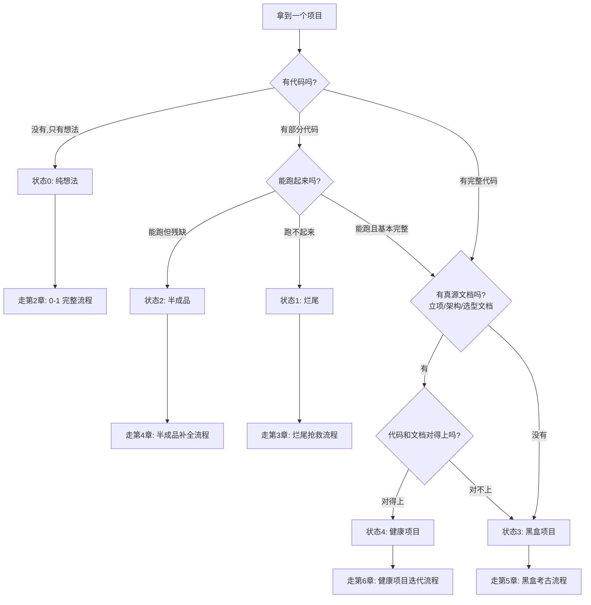
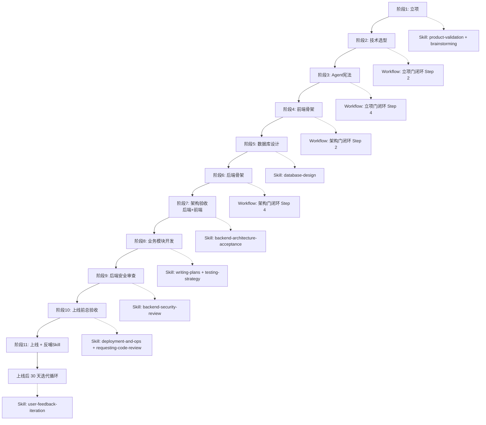
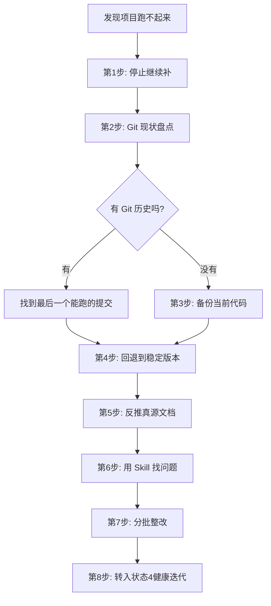
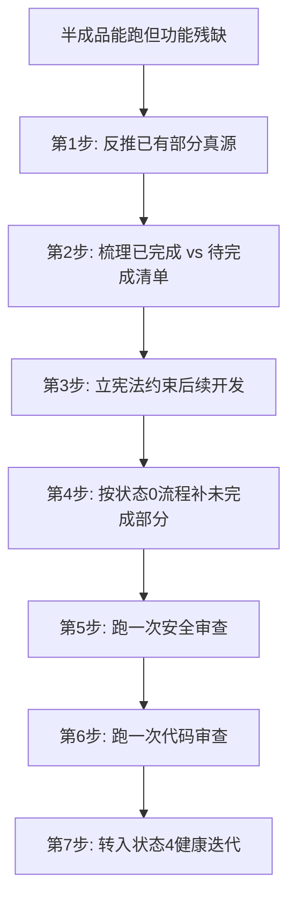
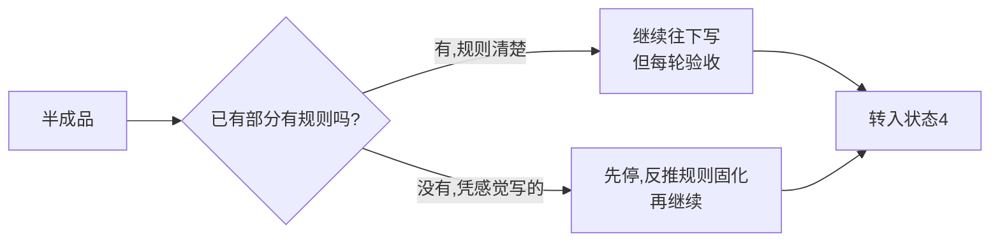
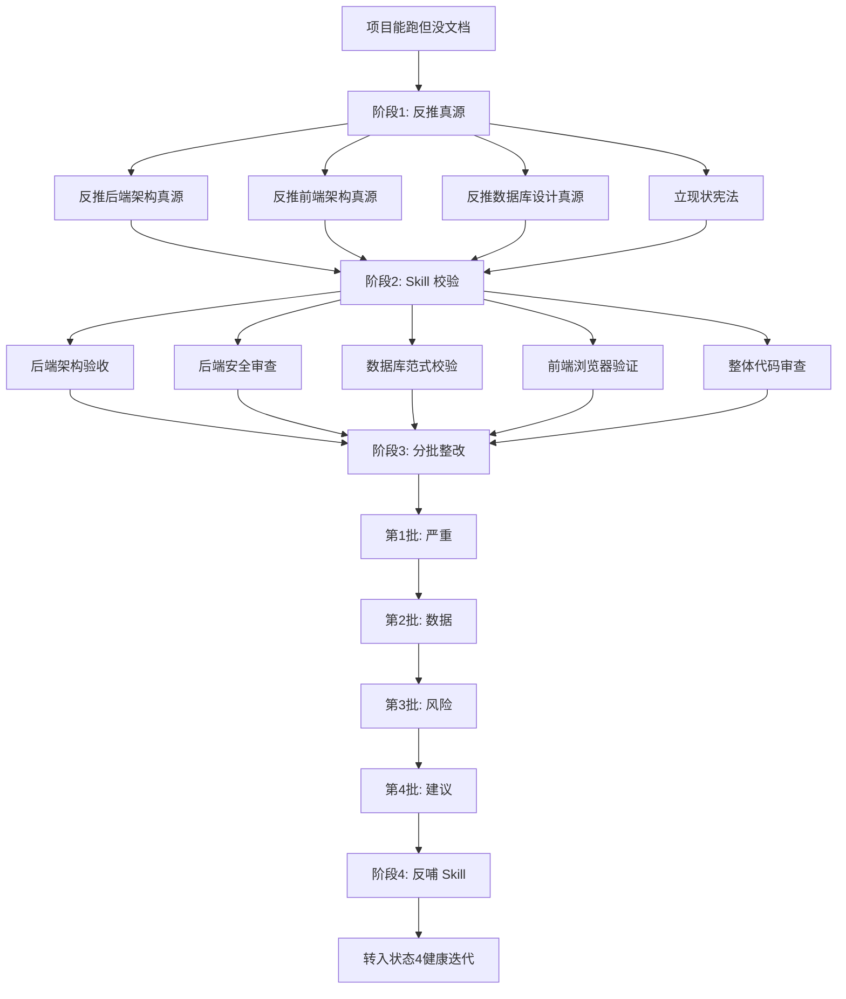
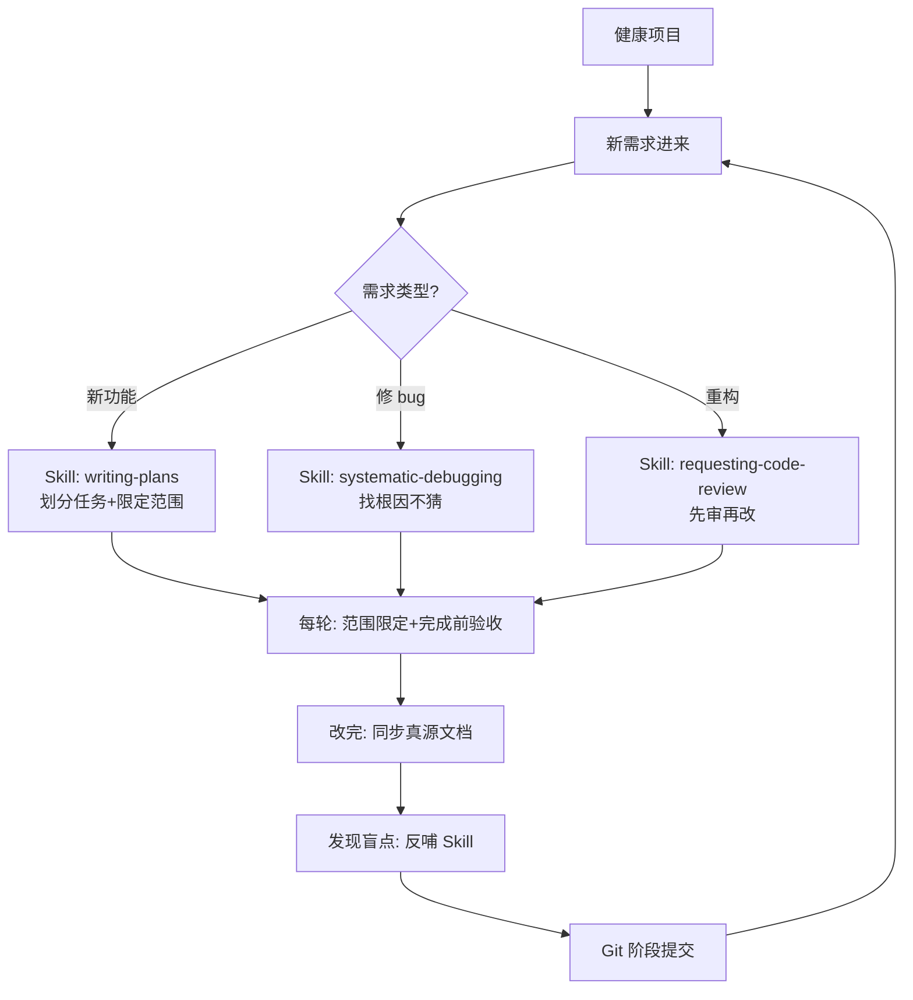
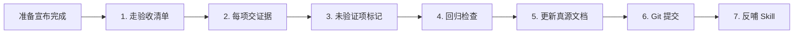
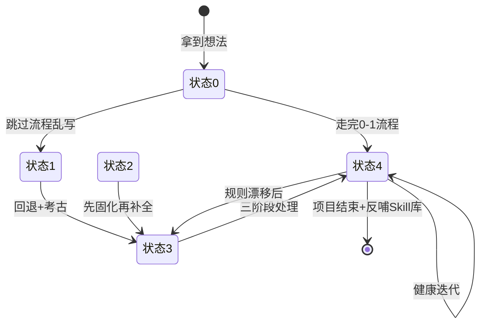

# Vibe Coding 项目可视化流程手册

> 适用场景：拿到一个项目，不知道从哪开始、走哪条路、每步该干什么。
> 用法：先看第一章判断项目状态 → 跳到对应章节 → 按流程图执行 → 每步参考"计划方向"卡片。

***

## 第一章：先判断项目处于什么状态

### 1.1 项目状态识别决策树



### 1.2 五种状态速查表

| 状态           | 特征              | 核心风险           | 起点章节  |
| ------------ | --------------- | -------------- | ----- |
| **状态 0**：纯想法 | 只有脑子里的方向，没代码没文档 | AI 自由发挥、方向漂移   | 第 2 章 |
| **状态 1**：烂尾  | 有代码但跑不起来        | 越补越乱、改坏不可逆     | 第 3 章 |
| **状态 2**：半成品 | 能跑但功能残缺         | 范围失控、规则未立      | 第 4 章 |
| **状态 3**：黑盒  | 能跑但没文档或文档对不上    | AI 凭猜测改、必然漂移   | 第 5 章 |
| **状态 4**：健康  | 能跑、有文档、文档对得上    | 停滞迭代、Skill 不反哺 | 第 6 章 |

> **判断窍门**：90% 的"已完成项目"实际是状态 3（黑盒），不是状态 4。先按状态 3 走考古流程，别直接进迭代。

***

## 第二章：状态 0 — 纯想法（0-1 完整流程）

### 2.1 完整流程图



### 2.2 每阶段计划方向卡片

#### 📍 阶段 1：立项（1-2 轮对话）

| 项目           | 内容                                                                |
| ------------ | ----------------------------------------------------------------- |
| **目标**       | 把模糊想法变成可执行立项文档（PRD）                                                |
| **触发 Skill** | `product-validation.md` + `brainstorming.md` + Prompt模板库套路 A      |
| **关键约束**     | 不写代码、不装依赖、只讨论；先验证需求再写文档                                         |
| **产出**       | 立项文档（PRD 五段结构，10 项内容：立项说明 / 用户证据 / 功能边界 / Out-of-Scope / 流程路径 / 业务对象 / 技术路线 / 风险清单 / 里程碑 / 验收规则） |
| **Git 提交**   | `chore: 完成项目立项`                                                   |
| **判断通过**     | 至少 3 条真实用户证据 + Out-of-Scope 与风险清单已写 + AI 确认"暂时不写代码" + 立项文档已写入文件 |
| **常见坑**      | 跳过讨论直接让 AI 装依赖建项目；把朋友夸奖和假设性回答当成用户证据                                  |

#### 📍 阶段 2：技术选型（1 轮对话）

| 项目              | 内容                                                  |
| --------------- | --------------------------------------------------- |
| **目标**          | 把技术方案确定下来，不让后续摇摆                                    |
| **触发 Workflow** | `agent/workflows/立项门闭环.md` Step 2                         |
| **关键约束**        | 必须给唯一推荐，不要列多方案；写明运行时与数据库版本                              |
| **产出**          | 技术选型文档（前端框架+UI库 / 后端语言+框架 / 数据库 / 主要 SDK / 运行环境版本 / 选和不选的理由）+ `.env.example` + README |
| **Git 提交**      | `chore: 确定项目技术方案`                                    |
| **判断通过**        | AI 能说清"为什么不选其他方案" + README 能从零复现环境                      |
| **常见坑**         | 让 AI 列 3 套方案让你选（甩锅）；没写版本和包管理器，换台机器跑不起来                    |

#### 📍 阶段 3：Agent 宪法（1 轮对话）

| 项目              | 内容                                                                           |
| --------------- | ---------------------------------------------------------------------------- |
| **目标**          | 给 AI 立长期规矩，让它稳定不漂移                                                           |
| **触发 Workflow** | `agent/workflows/立项门闭环.md` Step 4                                             |
| **关键约束**        | 简短、明确、可检查；只写长期原则；含禁止事项和验收标准                                                   |
| **产出**          | `AGENT_CONSTITUTION.md` + 各 IDE 入口文件（`AGENTS.md`/`CLAUDE.md`/`.trae/rules/`） |
| **Git 提交**      | `chore: 创建项目 Agent 宪法`                                                       |
| **判断通过**        | 宪法不超过几百行 + 含项目专属条款                                                           |
| **常见坑**         | 把所有技术细节、目录结构塞进宪法                                                             |

#### 📍 阶段 4：前端骨架（1-2 轮对话）

| 项目              | 内容                                  |
| --------------- | ----------------------------------- |
| **目标**          | 在写页面前先把统一规则定下来                                  |
| **触发 Skill**    | `ui-design-system.md` + `agent/workflows/架构门闭环.md` Step 2 |
| **参考库**        | `references/UIUX参考库索引.md`（该索引按 14 阶段编号，前端骨架为阶段 6）→ `DESIGN_SYSTEM.md` §1–§8、§10、§11 / `projects.html` / `patterns.html` |
| **关键约束**        | 先定设计规范（风格 / token / 断点 / 页面状态 / 可访问性）/ 组件库 / 目录规则；本轮只搭最小可运行骨架 |
| **产出**          | 前端架构实施文档（含设计规范）+ 能启动 / 首页能打开的骨架 + 加载 / 空 / 错误状态示例 |
| **Git 提交**      | `feat: 搭建前端最小可运行骨架`                             |
| **判断通过**        | token 已定且页面只用 token、UI 组件库接入、能启动、移动端能打开、三种状态齐全、键盘可操作 |
| **常见坑**         | 一次性做完所有页面、到处手写组件、到处写十六进制颜色、只做桌面端                  |

#### 📍 阶段 5：数据库设计（1-2 轮对话）

| 项目           | 内容                                     |
| ------------ | -------------------------------------- |
| **目标**       | 先设计文件再建表，不直接连库建表                       |
| **触发 Skill** | `database-design.md` + `agent/workflows/架构门闭环.md` Step 3 |
| **关键约束**     | 先 schema/migration 后执行；三大范式校验；索引 / 事务 / 迁移 / 备份必须写 |
| **产出**       | `schema.sql` / migration + 数据库实施计划（含索引 / 事务 / 连接池 / 数据隔离 / 备份） |
| **Git 提交**   | `feat: 完成数据库设计文件并跑通基础结构`               |
| **判断通过**     | 能连接 / 能建表 / 能插入和查询测试数据 + 索引证据 + migration 有回退步骤 |
| **常见坑**      | 直接连库建表、密码明文、金额用浮点、给每列都建索引、多表写入不开事务            |

#### 📍 阶段 6：后端骨架（1-2 轮对话）

| 项目              | 内容                             |
| --------------- | ------------------------------ |
| **目标**          | 先写架构文档和接口清单再搭骨架，避免规则漂移                    |
| **触发 Skill**    | `api-design.md` + `agent/workflows/架构门闭环.md` Step 4 |
| **关键约束**        | 必须先有《项目架构设计文档》和《接口清单》再写代码                 |
| **产出**          | 后端架构实施文档 + 接口清单 + 最小可运行后端骨架                 |
| **Git 提交**      | `feat: 搭建后端最小可运行骨架，写入后端架构实施文档与接口清单`        |
| **判断通过**        | 启动线 / 接口线 / 业务线 / 运维线四条线跑通 + `.env.example` / README / 健康检查就绪 |
| **常见坑**         | 跳过架构文档直接写代码、接口清单只写代码注释、一上来写完整业务            |

#### 📍 阶段 7：架构验收（后端+前端）（1-2 轮对话）

| 项目           | 内容                                                               |
| ------------ | ---------------------------------------------------------------- |
| **目标**       | 用证据证明规则立住了，不是听 AI 说"已完成"。后端+前端分别验收                               |
| **触发 Skill** | `backend-architecture-acceptance.md` + `browser-verification.md` |
| **关键约束**     | 每项交证据（文件/命令/输出/日志/截图），未验证项标记"未验证"；接口清单 / `.env.example` / 健康检查逐项核对 |
| **产出**       | 验收报告 + 《后端架构实施真源文档》+ 《前端架构实施真源文档》                                |
| **Git 提交**   | `chore: 架构验收通过，写入实施真源文档`                                         |
| **判断通过**     | 后端 11 种接口场景齐全 + 接口清单与实现一致 + 前端设计 token / 规范生效 + 浏览器验证通过         |
| **常见坑**      | 听"已完成"就放过、只验后端不验前端、把细则塞进宪法                                       |

#### 📍 阶段 8：业务模块开发（多轮，一个模块一轮）

| 项目           | 内容                                     |
| ------------ | -------------------------------------- |
| **目标**       | 一个模块一个模块加，每轮交付可验收小块                    |
| **触发 Skill** | `writing-plans.md` + `testing-strategy.md` + `verification-before-completion.md` + Prompt模板库套路 C/D/E |
| **关键约束**     | 每轮限定范围；先测试再验收；一个模块做完就提交                  |
| **产出**       | 业务接口 + 自动化回归测试 + 每轮 Git 提交             |
| **Git 提交**   | `feat: 完成 XX 模块（含 XX 接口）`              |
| **判断通过**     | 每轮验收清单全过 + 测试六步法走完 + 核心接口有自动化测试            |
| **常见坑**      | 一口气写完所有业务、跳过每轮验收、只测正常路径、用 mock 数据库代替真实查询          |

#### 📍 阶段 9：后端安全审查（1-2 轮对话）

| 项目           | 内容                                                              |
| ------------ | --------------------------------------------------------------- |
| **目标**       | 5 道安全关卡 + 认证 / 密钥 / 跨域 / 角色矩阵 / 限流逐项交证据                        |
| **触发 Skill** | `backend-security-review.md` + `frontend-security-review.md` + `agent/workflows/业务门闭环.md` Step 2 |
| **关键约束**     | 重点查水平越权 + 注入；密钥只从环境变量读；生产错误不暴露路径和调用信息                            |
| **产出**       | 安全边界表 + 权限设计表 + 认证密钥审查 + 安全审查报告 + 整改清单                          |
| **Git 提交**   | `chore: 后端安全审查通过`                                               |
| **判断通过**     | 5 道关卡全过、越权测试返回 403、CORS 白名单、登录等接口有限流、无高危依赖                      |
| **常见坑**      | 只做"要不要登录"忽略水平越权、CORS 写成 `*`、管理员按钮只在前端隐藏、接口不限流                 |

#### 📍 阶段 10：上线前总验收（1-2 轮对话）

| 项目           | 内容                                                                      |
| ------------ | ----------------------------------------------------------------------- |
| **目标**       | 上线前最后一次系统检查（代码 + 部署条件 + 对外能力）                                            |
| **触发 Skill** | `requesting-code-review.md` + `browser-verification.md` + `deployment-and-ops.md` + `seo-analytics-compliance.md` + Prompt模板库套路 H |
| **关键约束**     | 5 维度审查（结构/规则/安全/数据/可维护性）+ 上线检查清单 + 风险分级                              |
| **产出**       | 上线前验收报告 + 上线检查清单 + 整改清单                                                   |
| **Git 提交**   | `chore: 上线前总验收通过`                                                       |
| **判断通过**     | 无 🔴 严重项 + 检查清单逐项完成 + 监控与回滚已准备 + SEO / 统计 / 合规已确认                        |
| **常见坑**      | 跳过总验收直接上线、不备份就迁移、没演练回滚、没有监控和告警                                          |

#### 📍 阶段 11：上线 + 反哺 Skill

| 项目         | 内容                     |
| ---------- | ---------------------- |
| **目标**     | 真正部署上线 + 冒烟 / 监控 / 回滚 + 把踩的坑反哺到 Skill 库 |
| **关键动作**   | 构建→变量→迁移→备份→发布→证书→冒烟→日志监控→回滚演练；再整理盲点 → 改进 Skill 与 Prompt |
| **产出**     | 已上线系统 + 发布记录 + 复盘报告 + 30 天迭代计划 + 迭代后的 Skill 库 |
| **Git 提交** | 项目仓库发布记录 + 知识库反哺 commit |
| **判断通过**   | 生产地址可访问 + 冒烟通过 + 监控有数据 + 回滚已演练 + 指标基线已记录 + 至少反哺 1 条新经验 |
| **常见坑**    | 没冒烟就宣布上线成功、没有监控和回滚准备、上线记录不写版本号和部署命令、上线后不看指标 |

***

## 第三章：状态 1 — 烂尾抢救流程

### 3.1 抢救流程图



### 3.2 每步计划方向

#### 📍 第 1 步：停止继续补（最重要）

**为什么**：AI 越补越乱是 Vibe Coding 最常见的灾难。让它停比让它继续补成本低 10 倍。

**怎么说**：

```
停。当前改动已经背离目标。请先列出最近 3 次 Git 提交，告诉我每个版本做了什么。
我决定回退到哪个版本后，再重新开始这一轮。
```

#### 📍 第 2 步：Git 现状盘点

```
请执行：
1. git log --oneline -20  看最近 20 次提交
2. git status  看当前工作区状态
3. git diff --stat  看未提交改动规模
告诉我：当前能跑的最近版本是哪个？工作区有多少未提交改动？
```

#### 📍 第 3 步：备份（无 Git 时必做）

```bash
# 复制整个项目目录到 _backup_日期
cp -r 项目目录 项目目录_backup_20260629
```

**没 Git 就没法回退**——这也是为什么 Git 是 Vibe Coding 的后悔药。

#### 📍 第 4 步：回退到稳定版本

```
请帮我回退到 [commit-id]。
说明：回退后会丢失哪些改动？是否需要先 stash 当前未提交改动？
回退方式用 git reset --hard 还是 git checkout？给建议。
```

#### 📍 第 5-8 步：转入状态 3 流程

回退到能跑的版本后，按"状态 3 黑盒考古流程"走（第 5 章），把规则固化下来再继续。

***

## 第四章：状态 2 — 半成品补全流程

### 4.1 补全流程图



### 4.2 关键决策点

**半成品最危险的决策**：是继续往下写，还是先停？



> 90% 的半成品是"凭感觉写的"，应该走 D 路径——先固化再继续，否则越写越乱。

***

## 第五章：状态 3 — 黑盒考古流程（已完成项目最常见）

### 5.1 考古流程图



### 5.2 三阶段计划方向

#### 📍 阶段 1：反推固化（不整改）

**核心**：让 AI 读代码反推规则，写成真源文档。这一步不改任何代码。

**为什么不能跳**：直接校验会让 AI 用通用标准乱挑，挑的你不需要、需要的它挑不到。

**三个反推指令**（直接贴进 Claude Code）：

```
请阅读后端代码，反推并生成《后端架构实施真源文档》。不要改任何代码。
包含：语言框架 / 目录责任表 / 接口响应规则 / 错误处理 / 日志 / 数据库连接 / 权限入口 / 框架复用边界 / 新增模块规则 / 启动证据包。
每项给文件路径 + 行号作为证据。说不清的标记"未明确"。
```

```
请阅读前端代码，反推并生成《前端架构实施真源文档》。不要改任何代码。
包含：框架+UI库 / 设计风格 / 目录结构 / 设计token / 多语言主题 / 组件复用规则 / 路由 / 接口层 / 状态管理。
每项给文件路径作为证据。
```

```
请阅读数据库 schema / migration，反推并生成《数据库设计真源文档》。不要改任何代码。
包含：数据库服务 / 业务对象 / 对象关系 / 核心表 / 字段规范 / 软删除策略 / 三大范式校验。
每项给 schema 文件 + 行号作为证据。
```

#### 📍 阶段 2：Skill 校验（不整改）

固化完才能校验。5 个 Skill 跑一遍，输出整改清单：

| 顺序 | Skill                             | 关注重点               |
| -- | --------------------------------- | ------------------ |
| 1  | `backend-architecture-acceptance` | 目录责任、11 种接口场景、框架复用 |
| 2  | `backend-security-review`         | 5 道关卡、水平越权、注入      |
| 3  | `database-design`                 | 三大范式、密码哈希、金额浮点     |
| 4  | `browser-verification`            | 设计 token、组件复用、跨端单位 |
| 5  | `requesting-code-review`          | 5 维度审查、风险分级        |

#### 📍 阶段 3：分批整改 + 反哺

按严重度分批改，每批改完回归一次，改完同步真源文档，发现盲点反哺 Skill。

详见前面回复中"阶段三：分批整改"。

***

## 第六章：状态 4 — 健康项目迭代流程

### 6.1 迭代流程图



### 6.2 健康项目持续复利的 5 条规则

1. **每个新需求先制定计划**：用 `writing-plans.md`，不直接写代码
2. **每轮交付必走验收**：用 `verification-before-completion.md`，禁止"已完成"
3. **规则变更同步真源**：改了规则不改文档 = 下次 AI 又按旧规则写
4. **盲点反哺 Skill**：不改的 Skill 用 100 次也不会变强
5. **上线后按 30 天循环**：24 小时看错误率和核心流程，第 1 周归类反馈并用 RICE 排序，每周小步灰度，第 30 天对比基线决定哪些假设成立

### 6.3 上线后 30 天循环

按 `skills/user-feedback-iteration.md` 和 `templates/上线后30天迭代计划.md` 执行：

| 时间 | 要做什么 | 产出 |
|---|---|---|
| 上线 24 小时 | 看错误率、响应时间、核心流程是否可用 | 24 小时观察记录 |
| 第 1 周 | 登记全部用户反馈，按缺陷 / 体验 / 功能缺失 / 误解 / 价格归类 | 反馈清单 |
| 第 1 周 | 用 RICE 排序，选 1-3 个本周要验证的假设 | 本周迭代计划 |
| 每周 | 小步发布，灰度验证，出问题按回滚步骤退 | 发布记录 + 指标对比 |
| 第 30 天 | 对比基线，判断哪些假设成立、哪些需求放弃 | 30 天复盘 + Skill 反哺 |

指标基线至少 5 个：访问量、注册量、激活量、核心动作完成量（下单 / 支付 / 提交）、留存。

***

## 第七章：跨状态通用规则

### 7.1 每次对话的开场模板


**模板**：

```
当前阶段：[立项 / 选型 / 前端 / 数据库 / 后端 / 业务 / 验收 / 调试]
你的角色：[产品合伙人 / 架构顾问 / 代码审查员 / 调试员]
上下文：[贴立项/选型/真源文档]
约束：给唯一推荐，不要列多方案
本轮范围：只做 [具体任务]，不一次性做完
验收标准：[具体可检查标准]
```

### 7.2 每次对话的收尾模板



### 7.3 项目状态转移图



***

## 第八章：快速查阅表

### 8.1 状态 → 起点章节 → 首要动作

| 状态    | 起点    | 第一步做什么                |
| ----- | ----- | --------------------- |
| 0 纯想法 | 第 2 章 | 先用 `product-validation` 验证需求，再用 `brainstorming` 跑立项 |
| 1 烂尾  | 第 3 章 | 停止补，先 Git 盘点          |
| 2 半成品 | 第 4 章 | 反推已有部分真源              |
| 3 黑盒  | 第 5 章 | 反推三份真源文档              |
| 4 健康  | 第 6 章 | 每个需求先制定计划              |

### 8.2 阶段 → Skill/Prompt 速查

| 阶段     | Skill                           | Workflow | Prompt 套路 |
| ------ | ------------------------------- | -------- | --------- |
| 需求验证   | product-validation              | 立项门闭环 | A         |
| 立项     | brainstorming                   | 立项门闭环 | A         |
| 选型     | -                               | 立项门闭环 Step 2 | B         |
| 宪法     | -                               | 立项门闭环 Step 4 | -         |
| 计划     | writing-plans                   | 架构门闭环 | C         |
| 前端骨架   | ui-design-system                | 架构门闭环 Step 2 | D         |
| 数据库    | database-design                 | 架构门闭环 Step 3 | -         |
| 后端骨架   | api-design                      | 架构门闭环 Step 4 | -         |
| 后端验收   | backend-architecture-acceptance | 架构门闭环 Step 6 | -         |
| 业务开发   | writing-plans + testing-strategy + verification-before-completion | 业务门闭环 | D, E      |
| 安全审查   | backend-security-review + frontend-security-review | 业务门闭环 Step 2 | F         |
| 调试     | systematic-debugging            | -        | G         |
| 代码审查   | requesting-code-review          | 业务门闭环 | H         |
| 前端验收   | browser-verification            | 架构门闭环 | -         |
| 上线验收   | deployment-and-ops + seo-analytics-compliance | 上线门闭环 Step 1 | -         |
| 上线反哺   | user-feedback-iteration         | 上线门闭环 Step 2-3 | -         |
| Git 提交 | -                               | -        | -         |

### 8.3 一句话心法（贴在显示器上）

> **AI 没记忆 → 文档是它的记忆**
> **AI 默认动手 → 你要逼它先想**
> **AI 默认讨好 → 你要逼它给判断**
> **AI 默认结论 → 你要逼它给证据**
> **AI 默认前进 → 你要逼它会停**
> **AI 会偷懒 → 一句话甩过去它就脑补，必须给够上下文和约束**

***

## 使用建议

1. **每个新项目开始前**：先翻第 1 章判断状态，再跳对应章节
2. **每个阶段开始前**：翻对应"计划方向卡片"，确认目标/约束/产出/验收
3. **每次对话开始前**：用第 7.1 节开场模板
4. **每次对话收尾前**：用第 7.2 节收尾模板
5. **每三个月回看一次**：项目状态是否在向状态 4 演进，Skill 库是否在迭代

