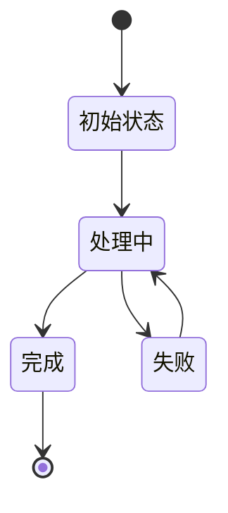

# 立项文档（PRD 结构）

> **用法**：新项目进入立项门时复制此结构，写入项目 `docs/a-立项文档.md`。
> 没有证据的内容标记为“假设”，不要写成结论。

---

## 0. 文档信息

- **项目名称**：
- **文档版本**：
- **日期**：
- **负责人**：
- **状态**：草稿 / 待确认 / 已确认

---

## 1. 需求背景与目标

### 1.1 目标用户

- 用户类型：
- 使用场景：
- 使用频率：
- 当前替代方案：

### 1.2 场景与问题

- 用户上一次遇到问题是什么时候：
- 当时怎么处理：
- 付出了什么代价：
- 现有方案最难受的一步：

### 1.3 用户证据

| 来源类型 | 原话或行为 | 结论 | 证据强度 |
|---|---|---|---|
| 真实行为 / 访谈原话 / 竞品数据 / 个人推断 | | | 高 / 中 / 低 |

> 朋友夸奖、假设性回答、没有具体行为描述的内容，不能作为高强度证据。

### 1.4 成功指标

| 指标 | 当前基线 | 目标值 | 统计方式 |
|---|---|---|---|
| 核心任务完成率 | | | |
| 辅助指标 1 | | | |
| 辅助指标 2 | | | |

---

## 2. 方案概述

### 2.1 核心流程

1. 
2. 
3. 

### 2.2 角色

| 角色 | 能做什么 | 不能做什么 |
|---|---|---|
| | | |

### 2.3 范围边界

**第一版必须有：**

- 
- 

**后续版本：**

- 
- 

**明确不做（Out-of-Scope）：**

| 不做的事 | 原因 | 何时重新评估 |
|---|---|---|
| | | |

---

## 3. 具体方案

### 3.1 页面与交互

| 页面 | 路由 | 主要功能 | 关键状态 |
|---|---|---|---|
| | | | 加载 / 空 / 错误 / 成功 |

### 3.2 接口

| 路径与方法 | 用途 | 权限 | 入参 | 出参 | 错误码 |
|---|---|---|---|---|---|
| | | | | | |

### 3.3 数据对象

| 对象 | 主要字段 | 关系 | 保留策略 |
|---|---|---|---|
| | | | |

### 3.4 状态流转

### 3.5 权限

| 操作 | 需要登录 | 需要角色 | 是否需要检查数据归属 |
|---|---|---|---|
| | | | |

### 3.6 异常与边界

| 场景 | 系统行为 | 用户看到什么 |
|---|---|---|
| 空数据 | | |
| 参数错误 | | |
| 未登录 | | |
| 无权限 | | |
| 第三方服务失败 | | |
| 重复提交 | | |

---

## 4. 上线计划

### 4.1 阶段划分

| 阶段 | 目标 | 交付物 | 验收标准 |
|---|---|---|---|
| | | | |

### 4.2 依赖

- 外部服务：
- 账号与权限：
- 数据来源：
- 域名与部署：

### 4.3 风险

| 风险 | 影响 | 可能性 | 应对方式 |
|---|---|---|---|
| | | | |

### 4.4 验收方式

- 功能验收：
- 安全验收：
- 上线验收：
- 用户验证：

---

## 5. 附录

### 5.1 访谈记录

| 日期 | 用户类型 | 关键原话 | 结论 |
|---|---|---|---|
| | | | |

### 5.2 竞品与参考

| 名称 | 链接 | 可借鉴 | 不采用 |
|---|---|---|---|
| | | | |

### 5.3 待确认问题

- [ ] 
- [ ] 
- [ ] 

---

## 6. AI 复述检查

- [ ] AI 能说清目标用户和核心问题；
- [ ] AI 能说清第一版范围和 Out-of-Scope；
- [ ] AI 能指出歧义和无法验证的验收标准；
- [ ] AI 准备先做的三件事与文档一致；
- [ ] 复述不一致的问题已经回到文档修正。
